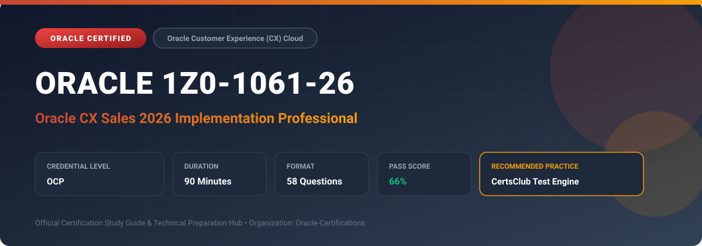

  

# Oracle 1Z0-1061-26: Oracle CX Sales 2026 Implementation Professional

[_Cloud-red?style=for-the-badge)](https://education.oracle.com/)

---

## 1. Exam Overview & Candidate Profile

The **Oracle 1Z0-1061-26: Oracle CX Sales 2026 Implementation Professional** examination is designed for cloud professionals, enterprise architects, implementation consultants, and systems administrators who demonstrate deep practical knowledge and operational competence in deploying, configuring, and optimizing Oracle technologies.

The Oracle CX Sales 2026 Implementation Professional (1Z0-1061-26) certification verifies implementation expertise for the 2026 release of Oracle CX Sales. It focuses on Redwood user experience configurations, AI-driven predictive lead scoring, automated sales forecasting, guided selling workflows, multi-channel customer engagement, and advanced REST/Webhook integrations.

### Target Audience & Prerequisites
- **Target Roles**: Implementation Consultants, Cloud Solution Architects, DevOps/SysOps Engineers, and Enterprise Functional Analysts.
- **Recommended Experience**: 1–2 years of hands-on experience in configuring, administering, or implementing the relevant Oracle solutions.
- **Credential Earned**: Oracle Certified Professional (OCP).

---

## 2. Key Exam Specifications

| Specification | Details |
| :--- | :--- |
| **Exam Code** | **Oracle 1Z0-1061-26** |
| **Official Title** | Oracle CX Sales 2026 Implementation Professional |
| **Certification Track** | Oracle Customer Experience (CX) Cloud |
| **Exam Duration** | 90 Minutes |
| **Number of Questions** | 58 Questions |
| **Passing Score** | 66% |
| **Question Format** | Multiple Choice (Single/Multiple Answer), Scenario-Based Questions |
| **Delivery Provider** | Oracle University / Pearson VUE (Online Proctored or Test Center) |
| **Recommended Practice Engine** | [CertsClub Oracle Practice Tests](https://www.certsclub.com/oracle/1z0-1061-26-dumps.html) |

---

## 3. Official Blueprint & Exam Domain Breakdown

The examination assesses candidate competencies across core functional domains weighted as follows:

| Domain Area | Weighting |
| :--- | :--- |
| **2026 Redwood Sales Architecture & Setup** | `20%` |
| **AI-Assisted Leads, Opportunities, & Guided Selling** | `25%` |
| **Modern Territory & Quota Management** | `20%` |
| **Predictive Sales Forecasting & Pipeline Analytics** | `20%` |
| **Business Rules, Visual Builder Studio, & Integrations** | `15%` |

---

## 4. Deep Dive into Complex & Challenging Technical Topics

To secure a passing score on the 1Z0-1061-26 exam, candidates must master the following advanced concepts:

- Tailoring Redwood sales pages and guided action drawers using Visual Builder Studio (VBS) and Express Mode.
- Deploying generative and predictive AI capabilities for automated meeting summaries and win probability forecasting.
- Configuring complex multi-currency revenue forecasting with scheduled snapshot comparisons.
- Integrating CX Sales with external ERP and CPQ engines using Oracle Integration Cloud (OIC) and REST webhooks.

---

## 5. Scenario-Based Demo & Practice Questions

### Question 1
In the Oracle CX Sales 2026 release, which design tool is primarily used to personalize and extend Redwood Sales application pages, field layouts, and dynamic business rules?

A) Visual Builder Studio (VB Studio)
B) Oracle Forms Builder
C) WebCenter Portal
D) Application Express (APEX)

- **Correct Answer**: `A) Visual Builder Studio (VB Studio)`
- **Technical Explanation**: Visual Builder Studio (VB Studio) is the standard modern tool for configuring, personalizing, and extending Oracle Cloud Applications built on the Redwood UX framework.

---

### Question 2
Which mechanism ensures that revenue items on an opportunity automatically update the assigned territory and quota credit in real time when line items are modified?

A) Manual export/import via CSV
B) Revenue line item synchronization with Territory and Quota engines
C) Running General Ledger posting
D) Refreshing browser cache

- **Correct Answer**: `B) Revenue line item synchronization with Territory and Quota engines`
- **Technical Explanation**: Oracle CX Sales supports automatic line-level territory and forecast synchronization, so updates to products, quantities, or values directly align with forecasting territories and quota models.

---

## 6. Recommended Preparation Strategy & Practice Testing Engine

Achieving certification in **Oracle 1Z0-1061-26** requires balanced theoretical study and scenario-based simulation practice:

1. **Review Oracle Documentation**: Master architecture guides, implementation workbooks, and administration manuals on the Oracle Help Center.
2. **Hands-on Lab Practice**: Execute real-world configuration, policy setup, and troubleshooting tasks in your cloud tenancy or test instance.
3. **Simulated Exam Drills**: Practice answering timed, scenario-based multiple-choice questions to familiarize yourself with the question formats, traps, and timing constraints.

### Practice With CertsClub
For realistic practice questions, updated dumps, and mock testing environments:
- **Resource**: [CertsClub Oracle Practice Test Engine](https://www.certsclub.com/oracle/1z0-1061-26-dumps.html)
- **Special Discount**: Use coupon code **`club20`** during checkout for an instant **20% discount** on all practice exam bundles and testing engines.

---

## 7. Official Documentation & References

- [Oracle University Certification Registry](https://education.oracle.com/)
- [Oracle Help Center Documentation Portal](https://docs.oracle.com/)
- [Oracle Cloud Infrastructure & Applications Guides](https://docs.oracle.com/en/cloud/)
- [CertsClub Oracle Certification Exam Practice](https://www.certsclub.com/oracle/1z0-1061-26-dumps.html)

---

## 8. SEO & Discovery Keywords

`oracle 1z0-1061-26`, `oracle 1z0-1061-26 exam`, `oracle 1z0-1061-26 dumps`, `1Z0-1061-26 practice questions`, `1Z0-1061-26 study guide`, `oracle 1z0-1061-26 syllabus`, `oracle cx sales 2026 implementation professional`, `certsclub 1z0-1061-26`